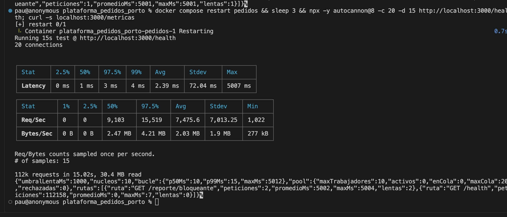
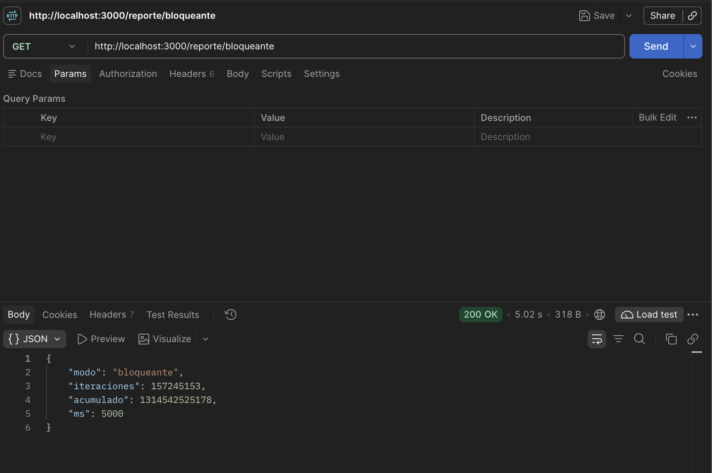
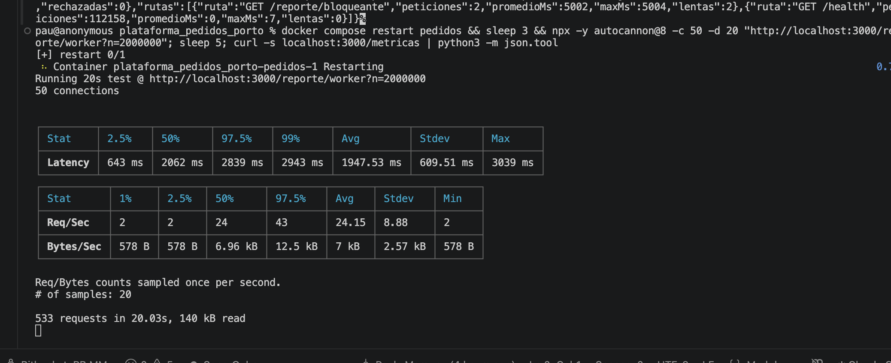
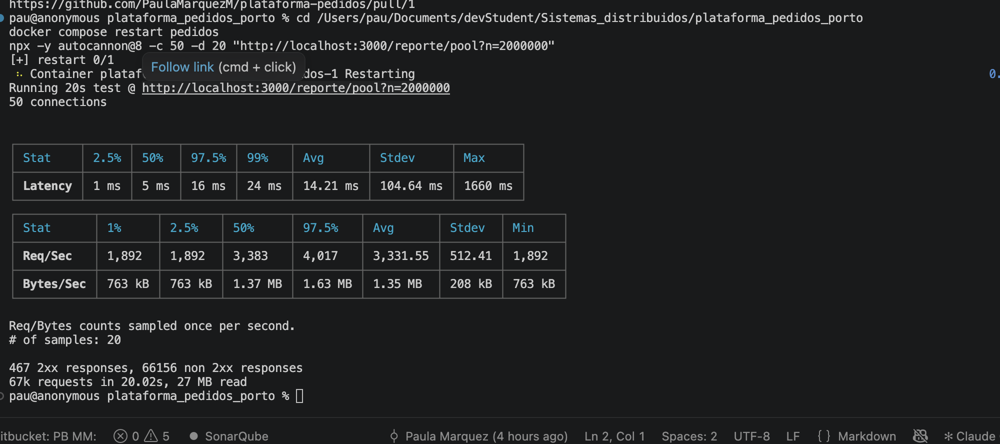

# Bitácora · Arquitecturas y procesos · Paula Márquez

## Entorno
| Dato | Valor |
| --- | --- |
| Laptop (CPU, RAM) | MacBook con Apple M4 (10 núcleos), 16 GB de RAM; Docker Desktop con 10 CPU y 7.7 GB asignados |
| nucleos según /metricas | 10 |
| MAX_TRABAJADORES y MAX_COLA | 10 y 20 (valores por defecto: `os.availableParallelism()` y el doble) |
| Duración de un reporte con n=2000000 | ~200 ms (197 ms en el pool, 198 ms en `/reporte/worker`, sin carga) |

## 1. Resultados
| Escenario | Latencia 50 % | Latencia máx. | Respuestas 2xx | Respuestas 503 | Timeouts | bucle.maxMs |
| --- | --- | --- | --- | --- | --- | --- |
| 1 · bloqueo (/health) | 1 ms | 5007 ms | 112 158 (todas) | 0 | 0 | 5012 |
| 2 · worker sin límite | 2062 ms | 3039 ms | 533 (todas) | 0 | 0 | 74 |
| 3 · pool con límite | 5 ms | 1660 ms | 467 | 66 156 | 0 | 42 |

Cada escenario se ejecutó en mi terminal después de `docker compose restart pedidos`, y al terminar se consultó `GET /metricas`. Las capturas están en `docs/s2/capturas/`.

### Escenario 1 · bloqueo
`npx -y autocannon@8 -c 20 -d 15 http://localhost:3000/health`

Mientras corría la carga, envié dos veces `GET http://localhost:3000/reporte/bloqueante` desde Postman (cada una respondió 200 OK en 5.02 s).

```
Running 15s test @ http://localhost:3000/health
20 connections

┌─────────┬──────┬──────┬───────┬──────┬─────────┬──────────┬─────────┐
│ Stat    │ 2.5% │ 50%  │ 97.5% │ 99%  │ Avg     │ Stdev    │ Max     │
├─────────┼──────┼──────┼───────┼──────┼─────────┼──────────┼─────────┤
│ Latency │ 0 ms │ 1 ms │ 3 ms  │ 4 ms │ 2.39 ms │ 72.04 ms │ 5007 ms │
└─────────┴──────┴──────┴───────┴──────┴─────────┴──────────┴─────────┘
┌───────────┬─────┬──────┬─────────┬─────────┬─────────┬──────────┬────────┐
│ Stat      │ 1%  │ 2.5% │ 50%     │ 97.5%   │ Avg     │ Stdev    │ Min    │
├───────────┼─────┼──────┼─────────┼─────────┼─────────┼──────────┼────────┤
│ Req/Sec   │ 0   │ 0    │ 9,103   │ 15,519  │ 7,475.6 │ 7,013.25 │ 1,022  │
├───────────┼─────┼──────┼─────────┼─────────┼─────────┼──────────┼────────┤
│ Bytes/Sec │ 0 B │ 0 B  │ 2.47 MB │ 4.21 MB │ 2.03 MB │ 1.9 MB   │ 277 kB │
└───────────┴─────┴──────┴─────────┴─────────┴─────────┴──────────┴────────┘

Req/Bytes counts sampled once per second.
# of samples: 15

112k requests in 15.02s, 30.4 MB read
```

`/metricas` al terminar:

```json
{
  "umbralLentaMs": 1000,
  "nucleos": 10,
  "bucle": {
    "p50Ms": 10,
    "p99Ms": 15,
    "maxMs": 5012
  },
  "pool": {
    "maxTrabajadores": 10,
    "activos": 0,
    "enCola": 0,
    "maxCola": 20,
    "rechazadas": 0
  },
  "rutas": [
    {
      "ruta": "GET /reporte/bloqueante",
      "peticiones": 2,
      "promedioMs": 5002,
      "maxMs": 5004,
      "lentas": 2
    },
    {
      "ruta": "GET /health",
      "peticiones": 112158,
      "promedioMs": 0,
      "maxMs": 7,
      "lentas": 0
    }
  ]
}
```




### Escenario 2 · un hilo por petición, sin límite
`npx -y autocannon@8 -c 50 -d 20 "http://localhost:3000/reporte/worker?n=2000000"`

```
Running 20s test @ http://localhost:3000/reporte/worker?n=2000000
50 connections

┌─────────┬────────┬─────────┬─────────┬─────────┬────────────┬───────────┬─────────┐
│ Stat    │ 2.5%   │ 50%     │ 97.5%   │ 99%     │ Avg        │ Stdev     │ Max     │
├─────────┼────────┼─────────┼─────────┼─────────┼────────────┼───────────┼─────────┤
│ Latency │ 643 ms │ 2062 ms │ 2839 ms │ 2943 ms │ 1947.53 ms │ 609.51 ms │ 3039 ms │
└─────────┴────────┴─────────┴─────────┴─────────┴────────────┴───────────┴─────────┘
┌───────────┬───────┬───────┬─────────┬─────────┬───────┬─────────┬───────┐
│ Stat      │ 1%    │ 2.5%  │ 50%     │ 97.5%   │ Avg   │ Stdev   │ Min   │
├───────────┼───────┼───────┼─────────┼─────────┼───────┼─────────┼───────┤
│ Req/Sec   │ 2     │ 2     │ 24      │ 43      │ 24.15 │ 8.88    │ 2     │
├───────────┼───────┼───────┼─────────┼─────────┼───────┼─────────┼───────┤
│ Bytes/Sec │ 578 B │ 578 B │ 6.96 kB │ 12.5 kB │ 7 kB  │ 2.57 kB │ 578 B │
└───────────┴───────┴───────┴─────────┴─────────┴───────┴─────────┴───────┘

Req/Bytes counts sampled once per second.
# of samples: 20

533 requests in 20.03s, 140 kB read
```

`/metricas` al terminar:

```json
{
  "umbralLentaMs": 1000,
  "nucleos": 10,
  "bucle": {
    "p50Ms": 11,
    "p99Ms": 22,
    "maxMs": 74
  },
  "pool": {
    "maxTrabajadores": 10,
    "activos": 0,
    "enCola": 0,
    "maxCola": 20,
    "rechazadas": 0
  },
  "rutas": [
    {
      "ruta": "GET /reporte/worker",
      "peticiones": 484,
      "promedioMs": 1932,
      "maxMs": 3020,
      "lentas": 440
    }
  ]
}
```



### Escenario 3 · pool con límite
`npx -y autocannon@8 -c 50 -d 20 "http://localhost:3000/reporte/pool?n=2000000"`

```
Running 20s test @ http://localhost:3000/reporte/pool?n=2000000
50 connections

┌─────────┬──────┬──────┬───────┬───────┬──────────┬───────────┬─────────┐
│ Stat    │ 2.5% │ 50%  │ 97.5% │ 99%   │ Avg      │ Stdev     │ Max     │
├─────────┼──────┼──────┼───────┼───────┼──────────┼───────────┼─────────┤
│ Latency │ 1 ms │ 5 ms │ 16 ms │ 24 ms │ 14.21 ms │ 104.64 ms │ 1660 ms │
└─────────┴──────┴──────┴───────┴───────┴──────────┴───────────┴─────────┘
┌───────────┬────────┬────────┬─────────┬─────────┬──────────┬────────┬────────┐
│ Stat      │ 1%     │ 2.5%   │ 50%     │ 97.5%   │ Avg      │ Stdev  │ Min    │
├───────────┼────────┼────────┼─────────┼─────────┼──────────┼────────┼────────┤
│ Req/Sec   │ 1,892  │ 1,892  │ 3,383   │ 4,017   │ 3,331.55 │ 512.41 │ 1,892  │
├───────────┼────────┼────────┼─────────┼─────────┼──────────┼────────┼────────┤
│ Bytes/Sec │ 763 kB │ 763 kB │ 1.37 MB │ 1.63 MB │ 1.35 MB  │ 208 kB │ 763 kB │
└───────────┴────────┴────────┴─────────┴─────────┴──────────┴────────┴────────┘

Req/Bytes counts sampled once per second.
# of samples: 20

467 2xx responses, 66156 non 2xx responses
67k requests in 20.02s, 27 MB read
```

`/metricas` al terminar:

```json
{
  "umbralLentaMs": 1000,
  "nucleos": 10,
  "bucle": {
    "p50Ms": 12,
    "p99Ms": 21,
    "maxMs": 42
  },
  "pool": {
    "maxTrabajadores": 10,
    "activos": 0,
    "enCola": 0,
    "maxCola": 20,
    "rechazadas": 66176
  },
  "rutas": [
    {
      "ruta": "GET /reporte/pool",
      "peticiones": 66644,
      "promedioMs": 9,
      "maxMs": 1658,
      "lentas": 449
    }
  ]
}
```



## 2. Análisis

**1. Escenario 1: `bucle.maxMs` frente al `maxMs` de `GET /health`.**
`bucle.maxMs` llegó a 5012 ms, pero en `rutas` el `maxMs` de `GET /health` fue solo 7 ms, aunque autocannon vio una latencia máxima de 5007 ms.
El interceptor solo empieza a medir cuando Express ejecuta `medirLatencia`. Mientras `/reporte/bloqueante` ocupa el hilo principal, las peticiones a `/health` esperan en el socket y nadie las cronometra; cuando por fin se atienden, responden en 0–7 ms.
`monitorEventLoopDelay`, en cambio, programa un temporizador cada 10 ms y mide cuánto se atrasa. Durante el bloqueo el temporizador no puede dispararse, y ese atraso (≈5 s) queda registrado.
Por eso el bucle ve el bloqueo y la métrica por ruta no: una mide el tiempo dentro del manejador, la otra mide si el proceso está libre para atender.

**2. Escenario 2: un hilo por petición, sin límite.**
Se completaron 533 peticiones en 20 s (484 registradas por el interceptor; la diferencia son las que seguían en curso cuando autocannon cortó) y hubo 0 timeouts.
Aun así, un reporte que tarda ~200 ms solo pasó a tener una latencia del 50 % de 2062 ms y máxima de 3039 ms, unas 10 veces peor; 440 de 484 fueron lentas (> 1000 ms).
Con 50 conexiones hay unos 50 workers a la vez compitiendo por 10 núcleos: cada uno recibe en promedio una quinta parte de CPU, y además crear un worker tiene un costo propio (un nuevo motor V8, memoria, arranque del módulo).
En mi máquina (10 núcleos) eso no alcanzó el timeout de 10 s de autocannon, pero en un equipo con 2–4 núcleos el mismo reparto multiplicaría la espera por 12–25 y aparecerían timeouts. Sin límite, más peticiones solo significan que todas terminan más tarde.

**3. Escenario 3: 2xx frente a 503, y 503 con Retry-After frente a timeout.**
Hubo 467 respuestas 2xx y 66 156 respuestas 503 (el pool contó 66 176 rechazadas). La latencia del 50 % fue 5 ms porque casi todas eran rechazos inmediatos.
El pool atendió más o menos el mismo trabajo útil que el escenario 2 (467 frente a 533), pero sin degradar a todas las peticiones: las aceptadas tardaron lo de un reporte y las demás se enteraron enseguida.
Un 503 inmediato con `Retry-After` es un fallo explícito y rápido (fail-fast): el cliente sabe al instante que la petición no se procesó, cuándo reintentar, y no gasta recursos esperando.
Un timeout es un fallo de omisión o de rendimiento: el cliente no recibe nada a tiempo y no sabe si el servidor está caído, lento o si la petición sí se procesó. Por eso se tiene que esperar el plazo completo y es riesgoso reintentar.

**4. autocannon ignora Retry-After.**
Como reintenta enseguida, las 50 conexiones generaron unas 3330 peticiones por segundo (67 k en 20 s) aunque solo ~23 por segundo podían atenderse.
El servidor gastó casi todo su tiempo en recibir, rechazar y registrar peticiones que no podía atender: el bucle subió a p99 = 21 ms y `maxMs` = 42 ms, y el contador de rechazadas llegó a 66 176. Es una pequeña tormenta de reintentos.
Un cliente bien diseñado debería respetar `Retry-After` (esperar al menos 1 s), usar backoff exponencial con jitter para no reintentar todos a la vez, poner un número máximo de reintentos y, si el 503 se repite, dejar de insistir por un tiempo (circuit breaker).

**5. Tres réplicas detrás de un balanceador.**
Cada réplica tiene sus propias métricas y su propia cola en memoria. `/metricas` mostraría solo los datos de la réplica que atendió esa petición, y cada vez podría salir una distinta, así que los números no representan el sistema completo.
En total podría haber hasta 3 × 10 = 30 reportes simultáneos (más 3 × 20 = 60 en cola), aunque cada réplica cree que el máximo es 10. Si las tres corren en la misma máquina de 10 núcleos, volvería la sobrecarga del escenario 2.
Cambiaría dos cosas: enviar las métricas a un sistema central (por ejemplo, Prometheus raspando cada réplica con una etiqueta por instancia) y sumar ahí; y usar una cola compartida (Redis/BullMQ o RabbitMQ) con un grupo de workers dimensionado para el total de núcleos, o al menos configurar `MAX_TRABAJADORES` por réplica como núcleos ÷ réplicas.

## 3. Problemas encontrados
- El proyecto local no tenía `/reporte/worker` ni `worker-reporte.ts`, así que los creé: `worker-reporte.ts` cuenta los primos hasta `n` (`primos.ts`) y `/reporte/worker` crea un worker por petición.
- TypeScript marcó `e` como `unknown` en los eventos `error` del worker; lo resolví tipando el parámetro como `Error`.
- En el escenario 1, el primer intento no sirvió: envié `/reporte/bloqueante` fuera de los 15 s de carga (autocannon marcó máximo 91 ms y `/metricas` solo 1 bloqueante). Lo repetí enviando las dos peticiones justo después de que apareció `Running 15s test`.
- En un intento del escenario 2 se coló un `/reporte/bloqueante` desde Postman y la latencia máxima subió a 7023 ms; lo repetí sin tocar Postman.
- La primera vez no guardé `/metricas` antes de reiniciar; desde entonces agregué `curl -s localhost:3000/metricas` al final del mismo comando.
- En el escenario 2 no aparecieron timeouts: con 10 núcleos, la latencia máxima (3 s) no llegó al límite de 10 s de autocannon.

## 4. Uso declarado de IA
Usé Claude (Claude Code) como asistente para implementar `pool.ts`, el retardo del bucle en `metricas.ts` y las rutas `/reporte/worker` y `/reporte/pool`, y para preparar el borrador de esta bitácora. Los escenarios los ejecuté yo con autocannon y Postman; revisé el código, los resultados y las respuestas del análisis antes de entregarlos.
